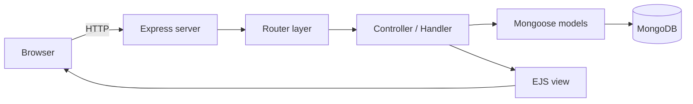
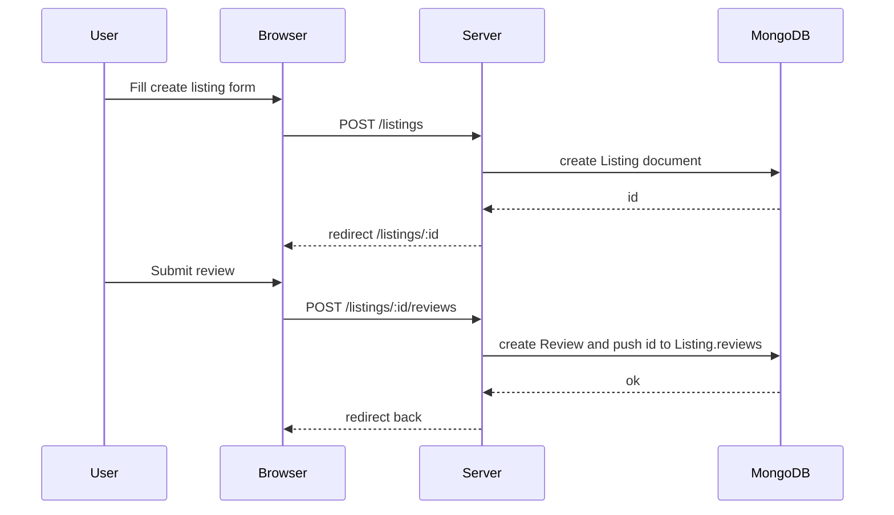
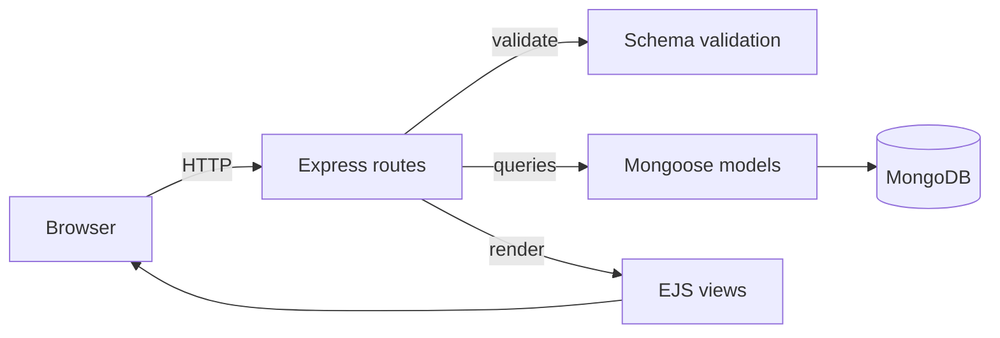

# Wanderlust

Wanderlust is a server-rendered travel-stay listing demo built with Node.js, Express, MongoDB and EJS. It demonstrates CRUD flows for listings and nested reviews, basic user authentication, and a responsive Bootstrap-based UI with dark mode support.

This README provides a compact reference with the project's purpose, features, tech stack, setup steps, and a concise list of routes and models.

---

## Key features

- Create, edit, delete travel listings (title, description, image, price, location)
- Add, list and delete reviews with star ratings and comments
- User signup/login and session-based authentication
- Server-side validation (Joi) and centralized error handling
- Responsive UI with light/dark theme toggling

---

## Tech stack

- Node.js + Express
- MongoDB + Mongoose
- Server-rendered views with EJS
- Bootstrap + custom CSS for styling

---

## Quick start (local)

1. Clone and install dependencies

```bash
git clone https://github.com/pranjalpanwar81/Wanderlust.git
cd Wanderlust
npm install
```

2. Start MongoDB (local) and seed demo data (optional)

```bash
# run MongoDB (example)
mongod --dbpath ~/mongodb-data

# seed sample listings (optional)
node init/index.js
```

3. Start the app

```bash
node app.js
```

4. Open `http://localhost:8080` in your browser.

Environment variables (optional):

- `DB_URL` — MongoDB connection string (default: mongodb://127.0.0.1:27017/wanderlust)
- `MAP_TOKEN` — map provider token used by the listing page
- `SESSION_SECRET` — session secret

---

## Important files & folders

- `app.js` — application entry and middleware
- `models/` — Mongoose schemas (`listing.js`, `review.js`, `user.js`)
- `routes/` — route definitions for listings, reviews, users
- `views/` — EJS templates and layouts
- `public/` — CSS, client JS and static assets
- `init/` — seed script for demo data

---

## Data model summary

- Listing: title, description, price, image, location, country, owner, reviews[]
- Review: rating (1-5), comment, author
- User: username, email, hashed password

Notes: Deleting a listing cascades to remove its reviews to avoid orphaned data.

---

## Key routes (quick reference)

Listings

- `GET /listings` — index
- `GET /listings/new` — new listing form
- `POST /listings` — create listing
- `GET /listings/:id` — show listing with reviews
- `GET /listings/:id/edit` — edit form
- `PUT /listings/:id` — update listing
- `DELETE /listings/:id` — delete listing

Reviews (nested)

- `POST /listings/:id/reviews` — create review
- `DELETE /listings/:id/reviews/:reviewId` — delete review

Auth

- `GET /signup`, `POST /users/signup`
- `GET /login`, `POST /login`
- `POST /logout`

---

## Scripts

- `npm start` — start the app
- `npm run dev` — start with nodemon for development
- `node init/index.js` — seed demo data
- `node scripts/capture-screenshots.js` — optional script to capture screenshots (requires Puppeteer and a running site)

---

## Development notes

- Validation: Joi schemas are used to validate incoming listing and review payloads before persistence.
- Error handling: async route handlers use a wrapper to forward errors to a centralized handler which renders `views/error.ejs`.
- Styling: main CSS is `public/css/style.css` (contains dark-mode rules under `body.dark-mode`).

---

## Screenshots / Proof

The repository contains a `docs/screenshots/` folder for optional proof images. The README intentionally leaves this area empty — add images there if you want to include visual proof.

---

## License & author

ISC License — author: pranjalpanwar81

---

If you want a different README style (shorter/longer, with diagrams, or formatted for a portfolio), tell me which format and I'll update it.
---

## Overview

Wanderlust is a minimal but complete example of a listings platform with the following capabilities:

- Create, edit and delete listings (title, description, image, price, location)
- Add and delete reviews on listings (rating 1–5 + comment)
- User authentication (signup/login) and session management
- Responsive UI built with Bootstrap and custom CSS; supports dark mode
- Server-side validation and safe async request handling

The app is suitable as a portfolio piece or a foundation for more advanced features (cloud storage, payments, search, pagination).

---

## Architecture & diagrams

The application follows a conventional MVC-style organization for small Express apps:

- Express application (`app.js`) — config, middleware, routes, error handling
- Routes — map HTTP endpoints to controller logic
- Controllers — application logic that interacts with models and renders views
- Models — Mongoose schemas for `Listing`, `Review`, `User`
- Views — EJS templates with partials and layouts under `views/`
- Static assets — `public/` contains CSS, JS and client assets

Service flow (request → response):



Data flow for Listings & Reviews:



---

## Data models (summary)

Below are concise descriptions of the primary Mongoose models. See the `models/` folder for full schemas.

- Listing
    - title: String
    - description: String
    - price: Number
    - image: { url: String, filename: String }
    - location, country: String
    - owner: ObjectId -> User
    - reviews: [ ObjectId -> Review ]

- Review
    - rating: Number (1..5)
    - comment: String
    - author: ObjectId -> User

- User
    - username: String
    - email: String
    - password: String (hashed in DB)

Important behaviors

- When a listing is deleted the app removes its associated reviews (cascade cleanup) to avoid orphaned documents.
- Validation is applied at the route layer (Joi) as well as using Mongoose schema constraints.

---

## REST routes (concise reference)

Listings

- GET /listings — listing index (grid)
- GET /listings/new — form to create a listing
- POST /listings — create a listing
- GET /listings/:id — show listing (details + reviews)
- GET /listings/:id/edit — edit form
- PUT /listings/:id — update listing
- DELETE /listings/:id — remove listing and associated reviews

Reviews (nested)

- POST /listings/:id/reviews — create review for listing
- DELETE /listings/:id/reviews/:reviewId — delete review

Authentication

- GET /signup — registration form
- POST /users/signup — create user
- GET /login — login form
- POST /login — authenticate user
- POST /logout — destroy session

---

## Pages and UI overview

The application uses server-rendered EJS templates located in `views/`. Key pages:

- `/listings` — index: grid of listing cards (image, title, price)
- `/listings/new` — new listing form (file upload, location, price, category)
- `/listings/:id` — show: large hero image, description, chips (price/location), reviews and review form
- `/signup` and `/login` — authentication forms

Notes about UI

- Theme color: primary accent uses an orange `#ff5722` across the site (buttons, links, highlights).
- Dark mode is implemented via a `body.dark-mode` class and CSS overrides in `public/css/style.css`.
- Cards and interactive elements use subtle transitions; the project includes CSS rules to remove or tune hover effects depending on preference.

---

## Developer setup (local)

Prerequisites

- Node.js 18+ (LTS recommended)
- MongoDB Community Server (or Atlas connection)

Quick start

```bash
# clone
git clone https://github.com/pranjalpanwar81/Wanderlust.git
cd Wanderlust

# install dependencies
npm install

# (optional) start local MongoDB if not using a remote DB
# mongod --dbpath ~/mongodb-data

# (optional) seed sample data
node init/index.js

# start the app
node app.js

# open http://localhost:8080
```

Configuration

- Environment variables can be provided via `.env` or your environment:
    - `DB_URL` (mongodb connection string)
    - `MAP_TOKEN` (map provider token)
    - `SESSION_SECRET` (session encryption secret)

---

## Seed data

The `init/` directory contains a simple script to populate the database with demo listings. Run `node init/index.js` to seed the database (useful for demo/testing). This script may replace existing demo data — back up production data before running.

---

## Scripts and automation

Common npm commands (check `package.json` scripts):

- `npm start` — start the app (production-like)
- `npm run dev` — start the app with nodemon/watchers for development

Automated screenshots

- There is an optional helper `scripts/capture-screenshots.js` using Puppeteer to capture pages and save full-page PNGs to `docs/screenshots/`. The README intentionally leaves the screenshot area empty; the script is provided for convenience if you want to generate visual proof locally.

---

## Testing & linting (notes)

- No automated tests are included by default. Suggested improvements:
    - Add Jest + supertest for request-level tests
    - Add ESLint and Prettier for consistent code style

---

## Deployment notes

- Production checklist:
    - Use a managed MongoDB (Atlas) or provisioned database with backups
    - Store environment variables securely (not in repo)
    - Serve behind a process manager (PM2) or container orchestrator
    - Offload images to cloud storage (S3 or similar) and serve via CDN

---

## Contributing

- Create a fork and send pull requests for small, focused changes.
- Include tests for new logic when possible.

---

## Screenshots (empty)

The `docs/screenshots/` folder exists in the repository for optional proof images. This README intentionally does not embed screenshots. Place any screenshots you want to include into that folder and update the README or open a PR to add them.

---

## License

This project is distributed under the ISC License.

---

If you want, I can later generate a concise PDF or a one-page summary for sharing; tell me what format you prefer.
---

## Overview

- Users can browse, create, edit, and delete travel listings.
- Each listing can receive reviews (1–5 stars + comment).
- Simple user authentication (signup/login) guards create/edit flows.
- UI uses Bootstrap with custom CSS and supports a dark mode theme.

## Architecture

High level components:
- Express app (`app.js`) exposes RESTful routes and renders EJS views.
- Mongoose models manage `Listing`, `Review`, and `User` documents.
- Static assets live in `public/` (CSS, client JS, images).
- `init/` provides a seed script to populate the database with sample data.

Mermaid service map:



System architecture (simplified):

```mermaid
graph TD
    A[Browser] --> B[Load pages & submit forms]
    B --> C[Express Server]
    C --> D[Auth middleware]
    C --> E[Validation (Joi)]
    E --> F[Mongoose models]
    F --> G[MongoDB]
    C --> H[Views (EJS + Bootstrap + custom CSS)]
```

---

## Data models (summary)

- Listing
    - title: String
    - description: String
    - image: { url, filename }
    - location, country
    - price: Number
    - owner: ObjectId → User
    - reviews: [ObjectId → Review]

- Review
    - rating: Number (1–5)
    - comment: String
    - author: ObjectId → User

- User
    - username, email, password (hashed)

Notes: Mongoose hooks remove reviews when a listing is deleted to keep data consistent.

---

## REST routes (concise)

Listings
- GET /listings — list all
- GET /listings/new — show new listing form
- POST /listings — create listing
- GET /listings/:id — show listing + reviews
- GET /listings/:id/edit — edit form
- PUT /listings/:id — update
- DELETE /listings/:id — delete

Reviews (nested)
- POST /listings/:id/reviews — create review
- DELETE /listings/:id/reviews/:reviewId — remove review

Auth
- GET /signup, POST /users/signup
- GET /login, POST /login

---

## Pages & Screenshots

The repository includes `docs/screenshots/` — add proof screenshots there. Example pages to capture:

- Homepage (`/listings` or `/`) — listings grid
- Listing show (`/listings/:id`) — listing details and review form
- New listing (`/listings/new`) — create listing form
- Signup (`/signup`) — sign up page
- Login (`/login`) — login page
- Any category/filter view you want to show

See the `Automated screenshots` section below for a script that captures these pages for you.

---

## Local setup

1. Clone and install dependencies

```bash
git clone https://github.com/pranjalpanwar81/Wanderlust.git
cd Wanderlust
npm install
```

2. Start MongoDB (local) and seed data (optional)

```bash

mongod --dbpath ~/mongodb-data

# Seed demo data (first time only)
node init/index.js
```

3. Start the app

```bash
node app.js
```

4. Open the site at `http://localhost:8080`

Environment variables
- `DB_URL` — MongoDB connection string (optional)
- `MAP_TOKEN` — Map provider key
- `SESSION_SECRET` — session secret

Create a `.env` file if you need to override defaults.

---

## Automated screenshots (Puppeteer)

I added a small Puppeteer script: `scripts/capture-screenshots.js`.

Usage:

```bash
# install puppeteer (required once)
npm install puppeteer --save-dev

# run the script (site must be running at http://localhost:8080)
node scripts/capture-screenshots.js

# screenshots will be saved to docs/screenshots/
```

The script visits the homepage, index, auth pages, and the first several listing detail pages it finds, saving full-page PNG screenshots.

---

## Tests & linting

This repository does not include formal unit tests yet. Recommended next steps:
- Add unit tests for controllers and model logic (e.g. Jest + supertest)
- Add linting (ESLint) and a pre-commit hook

---

## Deployment notes

- For production, host Node/Express behind a process manager (PM2) or containerize with Docker + deploy to a cloud provider.
- Use a managed MongoDB (Atlas) and configure `DB_URL` accordingly.
- Move image uploads to cloud storage (S3 or similar) rather than storing on the app server.

---

## Contributing

If you want help improving this project, feel free to open issues or send a pull request. Small, incremental changes and tests are appreciated.

---

## Screenshots / Proof

Add screenshots to `docs/screenshots/` (suggested names):

- `home.png`
- `listing_1.png`, `listing_2.png`, ...
- `signup.png`
- `login.png`

These will render in this README automatically when present.

---

## License

ISC License

---

If you want, I can run the screenshot script now and commit the captured images — confirm the app will be running at `http://localhost:8080` and I'll proceed to install Puppeteer and run the capture.
---

## Proof / Screenshots

Include visual proof of the running application by adding screenshots to the `docs/screenshots/` folder. Suggested filenames (the README will render them when present):

- `docs/screenshots/home.png` — Homepage / listing grid
- `docs/screenshots/listing_show.png` — Listing detail page (show view)
- `docs/screenshots/signup.png` — Sign up form
- `docs/screenshots/login.png` — Login form

Example Markdown that will display automatically when images are present:


If you'd like, upload the screenshots here or place them at `docs/screenshots/` locally and I can commit them for you.
