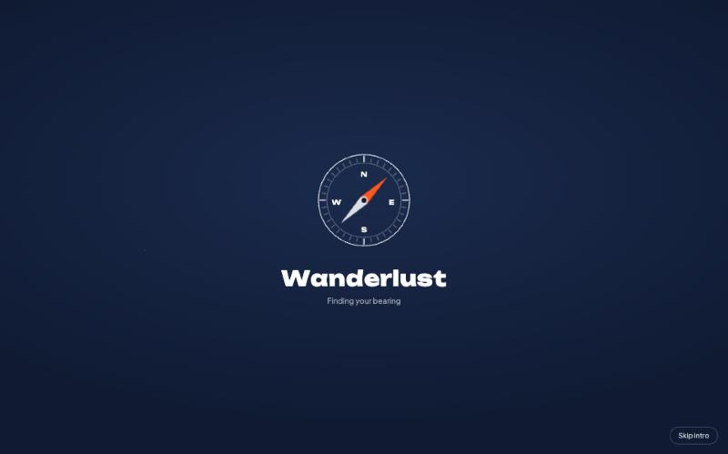
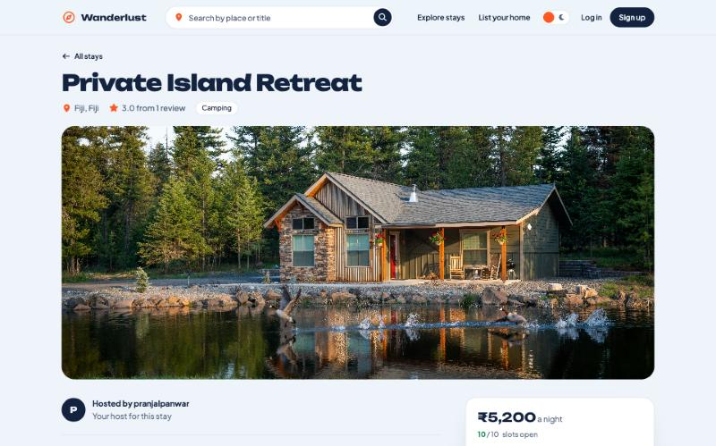
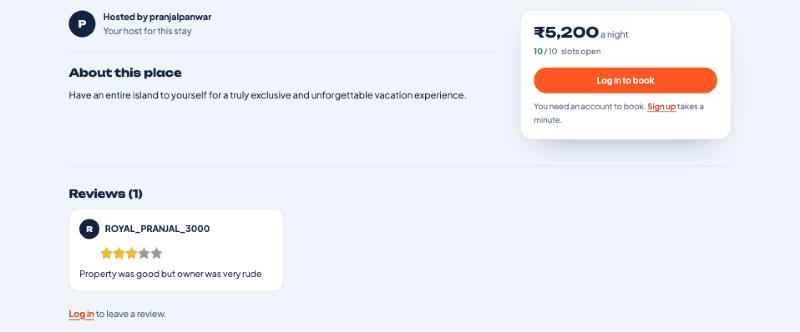
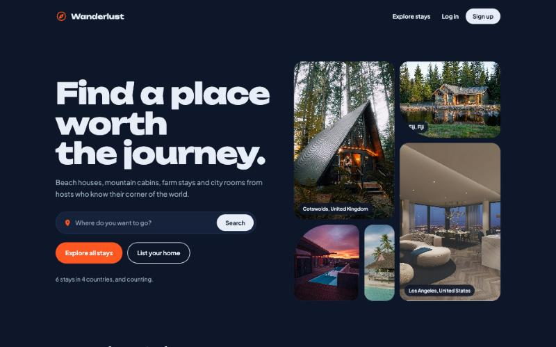
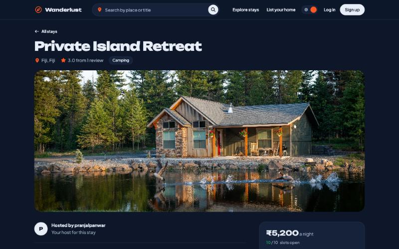
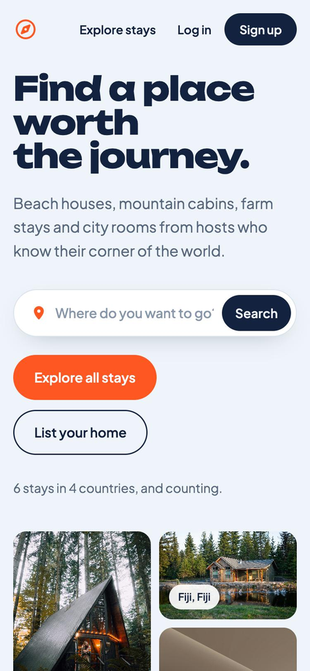
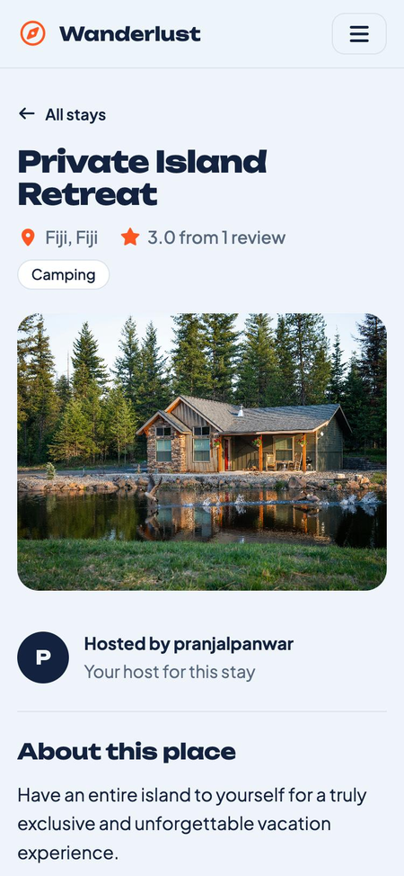

<div align="center">


# Wanderlust

**Find a place worth the journey.**

A full-stack travel stays app where people can list their homes, browse and book stays, and leave reviews.
Built with Node.js, Express, MongoDB and EJS, and deployed on Netlify.

### [View the live demo &nbsp;›](https://wanderlust-pranjal.netlify.app/)

[](https://wanderlust-pranjal.netlify.app/)


<br>

<a href="https://wanderlust-pranjal.netlify.app/"></a>

</div>

---

## Contents

- [Features](#features)
- [Screenshots](#screenshots)
- [Tech stack](#tech-stack)
- [How booking works](#how-booking-works)
- [Run it locally](#run-it-locally)
- [Project structure](#project-structure)
- [Deploying to Netlify](#deploying-to-netlify)
- [Known limitations](#known-limitations)
- [Contributing](#contributing)
- [Author](#author)

## Features

**For travellers**
- Browse every stay, or filter by kind of trip: beach, mountains, cabins, pools, camping, farms, arctic, trending and luxury.
- Search by place or title, sort by price or newest, and set a price range.
- Toggle prices to include taxes.
- See each stay's photo, host, description, reviews and location on an interactive Mapbox map.
- Book a stay with check-in and check-out dates and times, and see how many slots are still open.
- Leave a 1 to 5 star review, then edit or delete it later.

**For hosts**
- List a home with a photo (stored on Cloudinary), price, location and category.
- Edit or delete your own listings. Only the owner sees those controls.

**Across the app**
- Sign up, log in and log out, with sessions stored in MongoDB.
- Server-side validation with Joi, plus client-side form validation.
- A compass startup animation on the home page. It plays once per visit, can be skipped, and is turned off for people who prefer reduced motion.
- Light and dark mode that remembers your choice.
- Responsive layout from phones to wide screens.

## Screenshots

<table>
  <tr>
    <td width="50%"><br><sub><b>Startup animation.</b> A compass draws itself, the needle settles, and the page opens through it.</sub></td>
    <td width="50%"><br><sub><b>All stays.</b> Category filters, search, sort, price range and a taxes toggle.</sub></td>
  </tr>
  <tr>
    <td width="50%"><br><sub><b>Listing detail.</b> Title, rating, category and a full-width photo.</sub></td>
    <td width="50%"><br><sub><b>Booking and reviews.</b> A booking panel that stays in view, with guest reviews below.</sub></td>
  </tr>
  <tr>
    <td width="50%"><br><sub><b>Dark mode</b> on the home page.</sub></td>
    <td width="50%"><br><sub><b>Dark mode</b> on a listing.</sub></td>
  </tr>
</table>

<p align="center">
  
  &nbsp;&nbsp;
  
  <br><sub><b>On a phone.</b> Every page adapts down to small screens.</sub>
</p>

## Tech stack

| Layer | Tools |
|---|---|
| Server | Node.js, Express 4, `serverless-http` (Netlify Functions) |
| Views | EJS with `ejs-mate` layouts, Bootstrap 5 grid and components, custom CSS theme |
| Database | MongoDB Atlas with Mongoose 7 |
| Auth and sessions | Passport (`passport-local`, `passport-local-mongoose`), `express-session`, `connect-mongo` |
| Validation | Joi on the server, Bootstrap validation in the browser |
| Images | Multer with Cloudinary storage |
| Maps | Mapbox geocoding and Mapbox GL JS |
| Real time | Socket.IO, when running as a long-lived server |
| Hosting | Netlify (static files on the CDN, the Express app as one function) |

## How booking works

### Preventing double bookings

When two people book the same stay at the same moment, both requests can read the listing before either one writes. Without care, both bookings would be accepted.

Wanderlust uses **optimistic concurrency control** to stop that:

1. Each listing document has a version number (`__v`) that goes up on every change.
2. A booking is saved with `findOneAndUpdate` only if the version still matches the one that was read.
3. If another booking got there first, the version won't match. The update fails and the request retries after a short, increasing delay.
4. On every attempt, the server recounts confirmed bookings, so a stay can never be booked past its open slots.

```js
const listing = await Listing.findById(id).lean();
if (openSlots(listing) === 0) return fullyBooked();

const updated = await Listing.findOneAndUpdate(
  { _id: id, __v: listing.__v },                         // only if nobody changed it
  { $push: { bookings: newBooking }, $inc: { __v: 1 } },
  { new: true }
);

if (!updated) retryAfterDelay();                          // someone else booked first
```

No database locks are needed. When two requests race for the last slot, only one of them succeeds.

To try it, open the same listing in two browsers logged in as different users, and click **Book this stay** in both at once.

### Slots

Each listing has a capacity (`maxSlots`, 10 by default). Open slots are `maxSlots` minus confirmed bookings, and they go back up when a booking is cancelled. The booking panel marks a stay as *Filling up* at 3 or fewer slots. At 0 it hides the form and shows *Fully booked*.

### Live updates

When the app runs as a normal server (`npm start`), Socket.IO broadcasts `bookingCreated` and `bookingCancelled` events. Every open copy of that listing page then updates its slot count and booking list without a refresh.

## Run it locally

### Prerequisites

- Node.js 20 or newer
- A MongoDB database: [MongoDB Atlas](https://www.mongodb.com/atlas) (free tier works) or a local MongoDB server
- Optional: a [Cloudinary](https://cloudinary.com/) account for image uploads and a [Mapbox](https://www.mapbox.com/) token for maps

### 1. Clone and install

```bash
git clone https://github.com/pranjalpanwar81/Wanderlust.git
cd Wanderlust
npm install
```

### 2. Add a `.env` file

Create `.env` in the project root:

```bash
ATLASDB_URL=mongodb+srv://<user>:<password>@<cluster>.mongodb.net/wanderlust
SECRET=a-long-random-string
MAP_TOKEN=your-mapbox-public-token
CLOUDINARY_CLOUD_NAME=your-cloud-name
CLOUDINARY_API_KEY=your-api-key
CLOUDINARY_API_SECRET=your-api-secret
```

| Variable | Required | What it's for |
|---|---|---|
| `ATLASDB_URL` | Yes for anything but local Mongo | MongoDB connection string. Falls back to `mongodb://127.0.0.1:27017/wanderlust`. |
| `SECRET` | Yes | Signs session cookies. Use a long random string. |
| `MAP_TOKEN` | For maps | Mapbox token, used to geocode locations and draw the map. |
| `CLOUDINARY_CLOUD_NAME`, `CLOUDINARY_API_KEY`, `CLOUDINARY_API_SECRET` | For uploads | Where listing photos are stored. Without them, uploads are saved to `public/uploads/` (local only). |

`.env` is git-ignored. Never commit real credentials.

### 3. (Optional) Add sample data

```bash
node init/index.js
```

> **Warning:** this script deletes all existing listings, users and reviews before adding the samples. It connects to `mongodb://127.0.0.1:27017/wanderlust`, so it only touches a local database unless you edit it.

### 4. Start the app

```bash
npm start          # runs node app.js
```

Open [http://localhost:8080](http://localhost:8080).

For development with auto-reload, run `npm run dev:main`.

## Project structure

```
Wanderlust/
├── app.js                    # Express app: middleware, sessions, auth, routes
├── netlify/functions/
│   └── server.js             # Wraps app.js as a Netlify Function
├── netlify.toml              # Netlify build settings and routing
├── routes/                   # listing, review, booking and user routes
├── controllers/              # Route handlers for listings, reviews and users
├── models/                   # Mongoose schemas: listing (with bookings), review, user
├── middleware.js             # isLoggedIn, isAuthor, validation middleware
├── schema.js                 # Joi schemas
├── cloudConfig.js            # Cloudinary storage, with a local-disk fallback
├── views/
│   ├── home.ejs              # Landing page and startup animation
│   ├── layouts/              # Shared page layout
│   ├── includes/             # Navbar, footer, filters, flash messages
│   ├── listings/             # All stays, detail, new and edit
│   ├── reviews/              # Edit review
│   └── users/                # Log in and sign up
├── public/
│   ├── css/                  # style.css (app theme), home.css (landing), rating.css
│   └── js/                   # Form validation and map script
├── init/                     # Sample data and seed script
├── scripts/                  # One-off maintenance scripts
└── docs/screenshots/         # Images used in this README
```

## Deploying to Netlify

The live demo runs on Netlify. Netlify serves `public/` from its CDN and sends every other request to one serverless function that runs the whole Express app. `netlify.toml` already contains these settings:

```toml
[build]
  command   = "npm install"
  publish   = "public"
  functions = "netlify/functions"

[[redirects]]
  from   = "/*"
  to     = "/.netlify/functions/server/:splat"
  status = 200
```

To deploy your own copy:

1. Push the repo to GitHub.
2. In Netlify, choose **Add new project → Import an existing project → GitHub** and pick the repo and the `main` branch. The build settings fill in from `netlify.toml`.
3. Add the environment variables from the table above. **Import from a .env file** lets you paste them all at once.
4. In MongoDB Atlas, go to **Network Access** and allow `0.0.0.0/0`. Netlify Functions don't have fixed IP addresses.
5. Click **Deploy**. After that, every push to `main` redeploys automatically.

New Netlify projects can start out as **Private** (team only). To let anyone visit, open the project overview and click **Make public**.

## Known limitations

- **Live updates on Netlify.** Netlify Functions can't hold open WebSocket connections, so Socket.IO updates only work when you run the server yourself. On the live demo, other visitors see new bookings after a refresh.
- **Demo, not production.** For real use, you'd want rate limiting, email verification, password reset, payments, automated tests and monitoring.
- **Large photos.** Listing photos are served at their original size. Requesting resized versions from Cloudinary would make pages load faster.

## Contributing

Issues and pull requests are welcome.

1. Fork the repo and create a branch named `feat-<short-name>`.
2. Keep each change small and focused, and describe what it does and why.
3. For visual changes, include before and after screenshots.
4. Open a pull request against `main`.

## Author

Made by **Pranjal Panwar** ([@pranjalpanwar81](https://github.com/pranjalpanwar81)).

Licensed under the ISC license.
