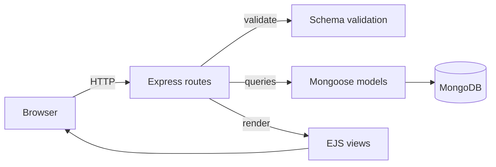
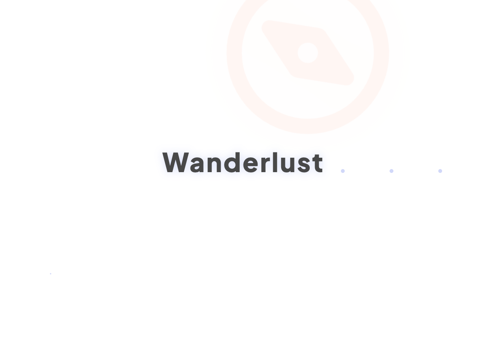
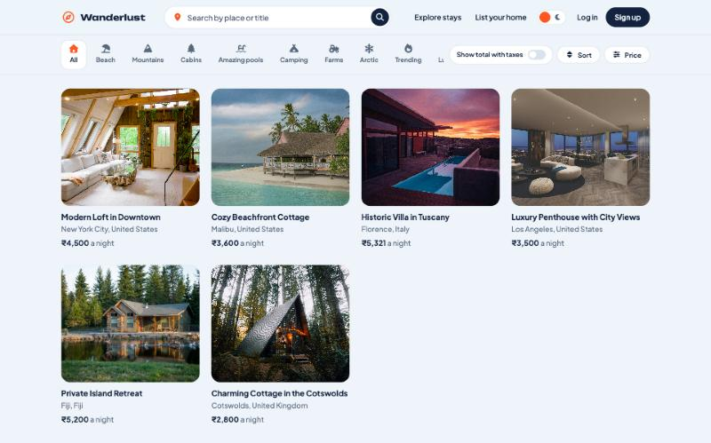
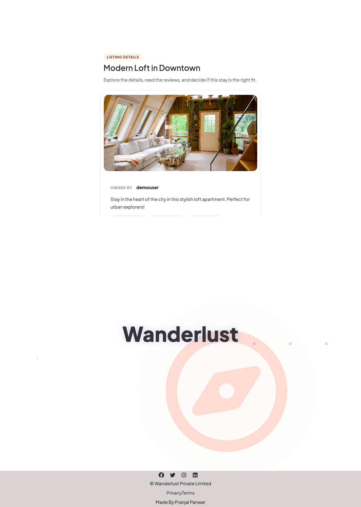
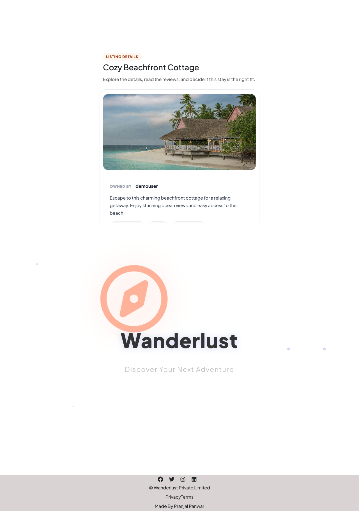

# Wanderlust — Travel-stay Listing Platform

Wanderlust is a full-stack, server-rendered travel listing/demo application implemented with Node.js, Express, MongoDB, and EJS. It demonstrates CRUD workflows, nested resources (listings with reviews), simple authentication, and responsive theming (light/dark). This README documents the architecture, data model, routes, developer setup, and how to produce visual proof (screenshots) of the running site.

Table of contents
- Overview
- Architecture & diagrams
- Data models
- REST routes
- Pages & UI overview (per-page screenshots)
- Local setup and development
- Automated screenshots (script)
- Tests & linting (notes)
- Deployment notes
- Contributing
- License

---

## Overview

- Users can browse, create, edit, and delete travel listings.
- Each listing can receive reviews (1–5 stars + comment).
- Simple user authentication (signup/login) guards create/edit flows.
- UI uses Bootstrap with custom CSS and supports a dark mode theme.

## Architecture

High level components:
- Express app (`app.js`) exposes RESTful routes and renders EJS views.
- Mongoose models manage `Listing`, `Review`, and `User` documents.
- Static assets live in `public/` (CSS, client JS, images).
- `init/` provides a seed script to populate the database with sample data.

Mermaid service map:



System architecture (simplified):

```mermaid
graph TD
    A[Browser] --> B[Load pages & submit forms]
    B --> C[Express Server]
    C --> D[Auth middleware]
    C --> E[Validation (Joi)]
    E --> F[Mongoose models]
    F --> G[MongoDB]
    C --> H[Views (EJS + Bootstrap + custom CSS)]
```

---

## Data models (summary)

- Listing
    - title: String
    - description: String
    - image: { url, filename }
    - location, country
    - price: Number
    - owner: ObjectId → User
    - reviews: [ObjectId → Review]

- Review
    - rating: Number (1–5)
    - comment: String
    - author: ObjectId → User

- User
    - username, email, password (hashed)

Notes: Mongoose hooks remove reviews when a listing is deleted to keep data consistent.

---

## REST routes (concise)

Listings
- GET /listings — list all
- GET /listings/new — show new listing form
- POST /listings — create listing
- GET /listings/:id — show listing + reviews
- GET /listings/:id/edit — edit form
- PUT /listings/:id — update
- DELETE /listings/:id — delete

Reviews (nested)
- POST /listings/:id/reviews — create review
- DELETE /listings/:id/reviews/:reviewId — remove review

Auth
- GET /signup, POST /users/signup
- GET /login, POST /login

---

## Pages & Screenshots

The repository includes `docs/screenshots/` — add proof screenshots there. Example pages to capture:

- Homepage (`/listings` or `/`) — listings grid
- Listing show (`/listings/:id`) — listing details and review form
- New listing (`/listings/new`) — create listing form
- Signup (`/signup`) — sign up page
- Login (`/login`) — login page
- Any category/filter view you want to show

See the `Automated screenshots` section below for a script that captures these pages for you.

---

## Local setup

1. Clone and install dependencies

```bash
git clone https://github.com/pranjalpanwar81/Wanderlust.git
cd Wanderlust
npm install
```

2. Start MongoDB (local) and seed data (optional)

```bash

mongod --dbpath ~/mongodb-data

# Seed demo data (first time only)
node init/index.js
```

3. Start the app

```bash
node app.js
```

4. Open the site at `http://localhost:8080`

Environment variables
- `DB_URL` — MongoDB connection string (optional)
- `MAP_TOKEN` — Map provider key
- `SESSION_SECRET` — session secret

Create a `.env` file if you need to override defaults.

---

## Automated screenshots (Puppeteer)

I added a small Puppeteer script: `scripts/capture-screenshots.js`.

Usage:

```bash
# install puppeteer (required once)
npm install puppeteer --save-dev

# run the script (site must be running at http://localhost:8080)
node scripts/capture-screenshots.js

# screenshots will be saved to docs/screenshots/
```

The script visits the homepage, index, auth pages, and the first several listing detail pages it finds, saving full-page PNG screenshots.

---

## Tests & linting

This repository does not include formal unit tests yet. Recommended next steps:
- Add unit tests for controllers and model logic (e.g. Jest + supertest)
- Add linting (ESLint) and a pre-commit hook

---

## Deployment notes

- For production, host Node/Express behind a process manager (PM2) or containerize with Docker + deploy to a cloud provider.
- Use a managed MongoDB (Atlas) and configure `DB_URL` accordingly.
- Move image uploads to cloud storage (S3 or similar) rather than storing on the app server.

---

## Contributing

If you want help improving this project, feel free to open issues or send a pull request. Small, incremental changes and tests are appreciated.

---

## Screenshots / Proof

Add screenshots to `docs/screenshots/` (suggested names):

- `home.png`
- `listing_1.png`, `listing_2.png`, ...
- `signup.png`
- `login.png`

These will render in this README automatically when present.

---

## License

ISC License

---

If you want, I can run the screenshot script now and commit the captured images — confirm the app will be running at `http://localhost:8080` and I'll proceed to install Puppeteer and run the capture.
---

## Proof / Screenshots

Include visual proof of the running application by adding screenshots to the `docs/screenshots/` folder. Suggested filenames (the README will render them when present):

- `docs/screenshots/home.png` — Homepage / listing grid
- `docs/screenshots/listing_show.png` — Listing detail page (show view)
- `docs/screenshots/signup.png` — Sign up form
- `docs/screenshots/login.png` — Login form

Example Markdown that will display automatically when images are present:










If you'd like, upload the screenshots here or place them at `docs/screenshots/` locally and I can commit them for you.
